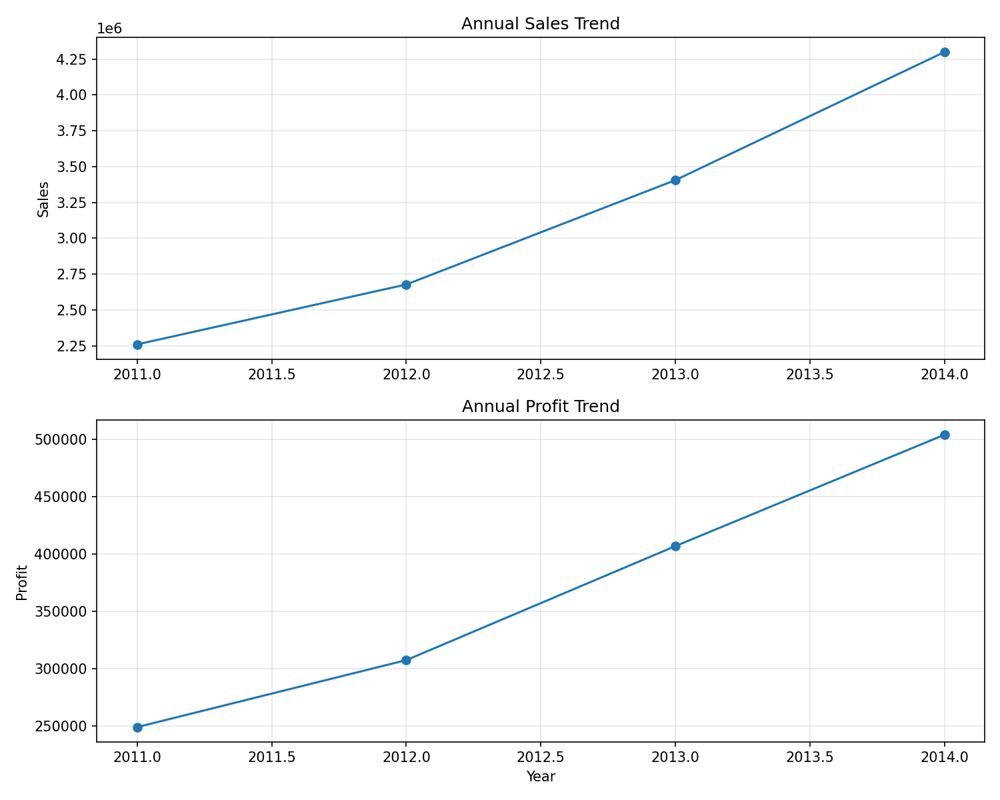
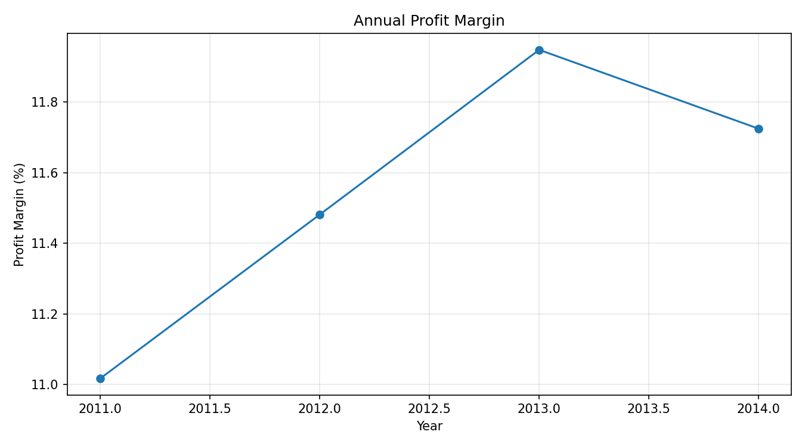
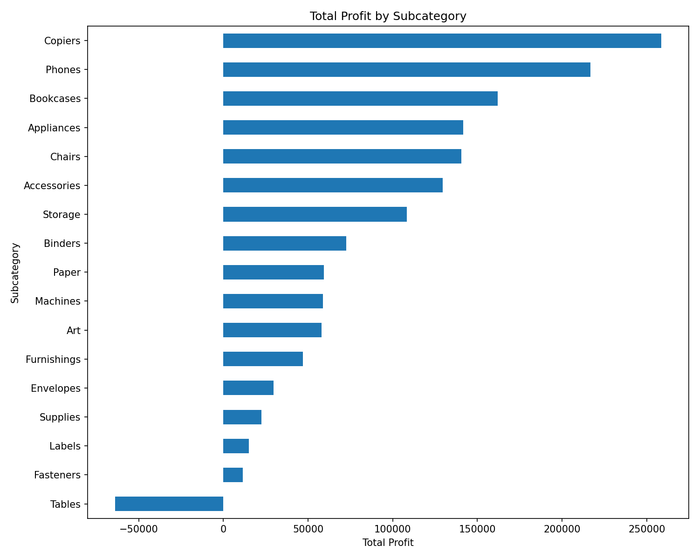
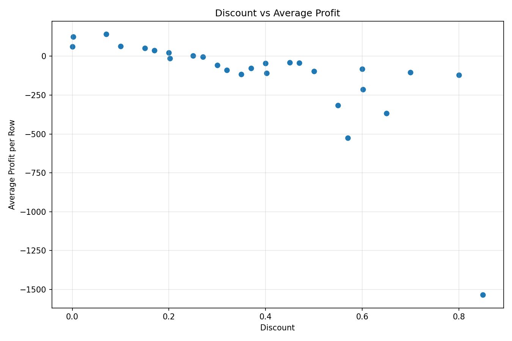
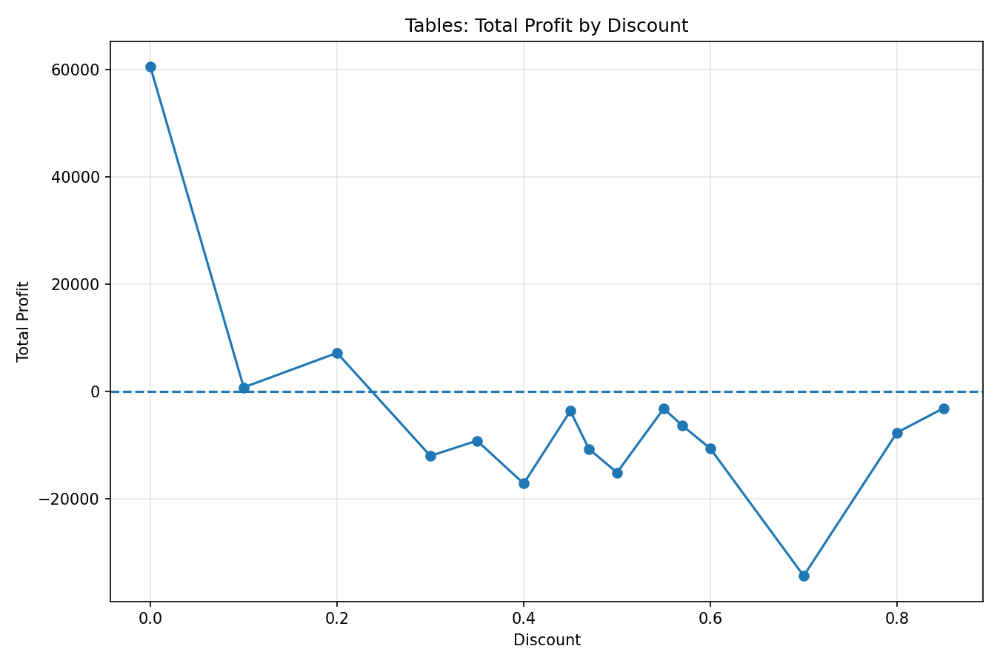
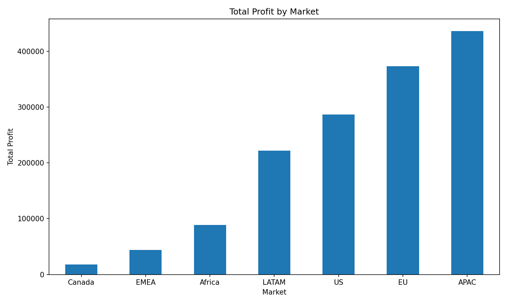
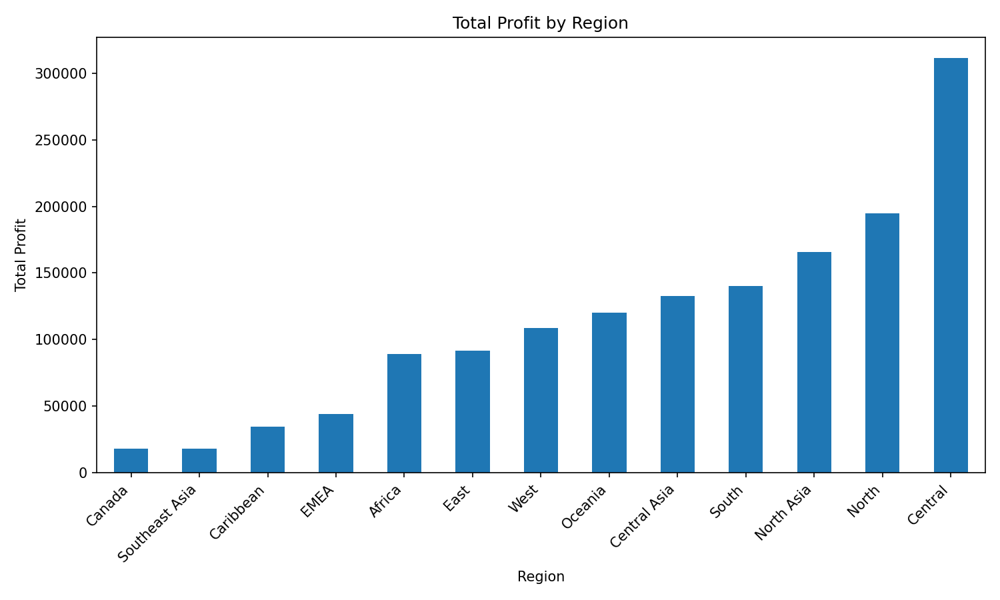
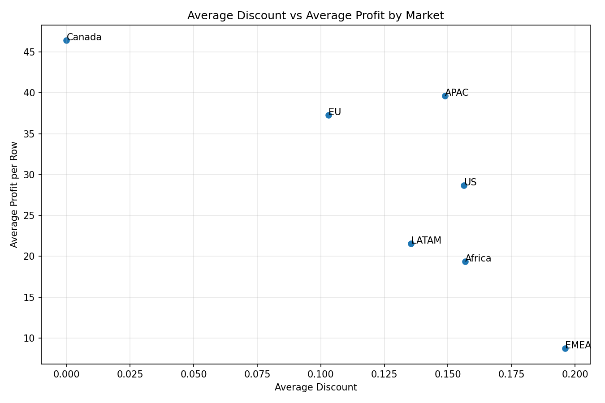

# Global Superstore: Sales & Profitability Analysis

**A portfolio project using Python, SQL Server, Pandas, Matplotlib, Jupyter Notebook, and Excel.**

[فارسی](#نسخه-فارسی) | [English](#english-version)

---

## English Version

### Project Overview

This project explores the Global Superstore dataset to understand sales trends, profitability, product performance, discount patterns, geographic markets, customer segments, and shipping operations. The goal is to turn transactional data into clear, evidence-based business findings.

### Dataset at a Glance

| Item | Description |
|---|---|
| Records | 51,290 rows |
| Columns after preparation | 26 |
| Order-date range | 2011-01-01 to 2014-12-31 |
| Main product categories | Furniture, Office Supplies, Technology |
| Markets | Africa, APAC, Canada, EMEA, EU, LATAM, US |

The dataset includes order and shipping dates, sales, profit, discounts, quantities, products, customers, customer segments, and geographic information. Monetary values are shown in the dataset's original units; no currency conversion is applied.

### Tools and Technologies

- **Python** — data preparation and analysis
- **Pandas** — data cleaning, grouping, and transformation
- **Matplotlib** — charts and visual exploration
- **Jupyter Notebook** — interactive analysis workflow
- **SQL Server / T-SQL** — validation and business-focused queries
- **Excel** — exported analysis tables
- **Git and GitHub** — version control and project presentation

### Key Findings

#### 1. Annual sales and profit

| Year | Total Sales | Total Profit | Profit Margin |
|---:|---:|---:|---:|
| 2011 | 2,259,511 | 248,940.81 | 11.02% |
| 2012 | 2,677,493 | 307,415.28 | 11.48% |
| 2013 | 3,405,860 | 406,935.23 | 11.95% |
| 2014 | 4,300,041 | 504,165.97 | 11.72% |

Sales and total profit increased each year. However, the profit margin peaked in 2013 at 11.95% and eased to 11.72% in 2014. This illustrates why revenue growth should be considered alongside profitability.





#### 2. Product subcategories

- **Copiers** generated the highest total profit among the subcategories in this analysis.
- **Tables** was the only subcategory with an overall net loss, approximately **-64,083.39**, with a profit margin of **-8.47%**.
- **Paper** had the highest subcategory profit margin at approximately **24.23%**.
- A high total profit and a high profit margin are different measures; both are useful when comparing product lines.



#### 3. Discounts and profitability

In the overall discount-band analysis, rows with discounts below 10% had a profit margin of about **25.08%**; the 10%–19.9% band had about **14.75%**, and the 20%–29.9% band had about **8.32%**. Bands starting at 30% were net loss-making in the aggregate results.

A focused analysis of globally loss-making products found that discount levels of 50% and above accounted for **60.88% of gross losses within that selected group**. This is a targeted finding, not a result for every product in the dataset.

These are descriptive associations, not proof that discounts alone caused losses. Product mix, market, order characteristics, and other factors may also affect profitability.





#### 4. Geographic markets

- **APAC** generated the highest total profit among the markets in the overall market analysis.
- **Canada** had the highest calculated overall profit margin (about **26.62%**) but a much smaller data volume than the other markets; the margin should therefore be interpreted in context.
- **EMEA** had the lowest overall market profit margin (about **5.45%**).
- From 2011 to 2014, Africa's annual market profit margin increased from **8.60%** to **13.90%**. EMEA's increased from **3.87%** to **7.49%**.
- EMEA recorded **47.42% sales growth** and **113.25% profit growth** in 2014 versus 2013. Growth rates should be read alongside the underlying totals and margins.







#### 5. Additional analysis

The notebook and SQL scripts also examine monthly trends, category performance, customer segments, shipping duration, market-by-year performance, product-level winners and loss-makers, and profit patterns across product subcategories and discount bands.

### Repository Structure

```text
Global-Superstore-Analysis/
├── data/
│   └── README.md
├── notebooks/
│   └── global_superstore_analysis.ipynb
├── plots/
│   ├── annual_profit_margin.png
│   ├── annual_sales_profit.png
│   ├── category_sales_profit.png
│   ├── discount_vs_profit.png
│   ├── market_discount_profit.png
│   ├── monthly_sales_profit.png
│   ├── profit_by_market.png
│   ├── profit_by_region.png
│   ├── profit_heatmap_subcategory_market.png
│   ├── segment_sales_profit.png
│   ├── shipping_duration.png
│   ├── subcategory_profit.png
│   └── tables_profit_by_discount.png
├── reports/
│   └── analysis_tables.xlsx
├── SQL/
│   └── global_superstore_analysis.sql
├── prepare_sql_data.py
├── requirements.txt
└── README.md
```

### How to Run the Python Analysis

1. Clone or download this repository.
2. From the project root, create and activate a virtual environment if desired.
3. Install dependencies:

   ```bash
   pip install -r requirements.txt
   ```

4. Open `notebooks/global_superstore_analysis.ipynb` in Jupyter Notebook or VS Code.
5. Run the notebook cells in order. The notebook expects the source dataset at `data/superstore.csv`.
6. Review generated charts in `plots/` and the Excel workbook in `reports/`.

### How to Run the SQL Analysis

The SQL script uses **Microsoft SQL Server / T-SQL** and expects a database named `GlobalSuperstoreDB` with the prepared table `dbo.superstore_sql_fixed`.

1. Run `prepare_sql_data.py` from the project root to generate `data/superstore_sql.csv` from `data/superstore.csv`.
2. Import `data/superstore_sql.csv` into SQL Server and create/populate the table `dbo.superstore_sql_fixed`. The SQL script expects this table to exist.
3. Open `SQL/global_superstore_analysis.sql` in SQL Server Management Studio (SSMS).
4. Confirm the database and table names, then execute the queries in sections.

**Data type note:** the imported SQL table used during this analysis stores fields as text. The queries use `TRY_CONVERT` to convert numeric and date values for calculations. For a production-quality database, define appropriate numeric and date column types during import.

### Limitations and Next Steps

- The analysis is descriptive; it does not establish causation.
- Large discount bands and small markets can have relatively few rows, so their margins may be volatile.
- Further work could include customer cohort analysis, statistical testing of discount-profit relationships, an interactive dashboard, and a more formal data model for SQL Server.

### Dataset

This project uses the Global Superstore dataset obtained from Kaggle.

Source: https://www.kaggle.com/datasets/fatihilhan/global-superstore-dataset

The raw dataset is not included in this repository. Please download it from the original source and place the required CSV file in the data/ directory.

---

## نسخه فارسی

### معرفی پروژه

این پروژه با هدف تحلیل داده‌های Global Superstore انجام شده است تا روند فروش، سودآوری محصولات، الگوهای تخفیف، عملکرد بازارهای جغرافیایی، بخش‌های مشتریان و عملیات ارسال سفارش‌ها بررسی شود. هدف، تبدیل داده‌های خام به یافته‌های تجاری روشن و قابل‌استناد است.

### مشخصات دیتاست

| ویژگی | توضیحات |
|---|---|
| تعداد رکوردها | ۵۱٬۲۹۰ ردیف |
| تعداد ستون‌ها پس از آماده‌سازی | ۲۶ |
| بازه تاریخ سفارش | ۲۰۱۱/۰۱/۰۱ تا ۲۰۱۴/۱۲/۳۱ |
| دسته‌های اصلی محصول | Furniture، Office Supplies، Technology |
| بازارها | Africa، APAC، Canada، EMEA، EU، LATAM، US |

داده‌ها شامل تاریخ سفارش و ارسال، فروش، سود، تخفیف، تعداد کالا، اطلاعات محصولات و مشتریان، بخش مشتری و اطلاعات جغرافیایی است. مقادیر پولی با واحد اصلی موجود در دیتاست نمایش داده شده‌اند و تبدیل ارزی انجام نشده است.

### ابزارهای استفاده‌شده

- **Python** برای آماده‌سازی و تحلیل داده
- **Pandas** برای پاک‌سازی، گروه‌بندی و تبدیل داده‌ها
- **Matplotlib** برای رسم نمودارها
- **Jupyter Notebook** برای تحلیل تعاملی
- **SQL Server و T-SQL** برای اعتبارسنجی داده و پرس‌وجوهای تجاری
- **Excel** برای ارائه جداول تحلیلی
- **Git و GitHub** برای کنترل ورژن و انتشار پروژه

### یافته‌های کلیدی

#### ۱. روند سالانه فروش و سود

| سال | فروش کل | سود کل | حاشیه سود |
|---:|---:|---:|---:|
| ۲۰۱۱ | 2,259,511 | 248,940.81 | ۱۱٫۰۲٪ |
| ۲۰۱۲ | 2,677,493 | 307,415.28 | ۱۱٫۴۸٪ |
| ۲۰۱۳ | 3,405,860 | 406,935.23 | ۱۱٫۹۵٪ |
| ۲۰۱۴ | 4,300,041 | 504,165.97 | ۱۱٫۷۲٪ |

فروش و سود کل در هر چهار سال افزایش داشته‌اند؛ بااین‌حال حاشیه سود در سال ۲۰۱۳ به ۱۱٫۹۵٪ رسید و در سال ۲۰۱۴ به ۱۱٫۷۲٪ کاهش یافت. بنابراین رشد فروش به‌تنهایی برای ارزیابی عملکرد تجاری کافی نیست.


#### ۲. عملکرد زیردسته‌های محصولات

- زیردسته **Copiers** بیشترین سود کل را در میان زیردسته‌ها ثبت کرده است.
- زیردسته **Tables** تنها زیردسته زیان‌ده در تحلیل کلی بوده و حدود **۶۴٬۰۸۳٫۳۹-** سود خالص داشته است؛ حاشیه سود آن **۸٫۴۷٪-** است.
- زیردسته **Paper** با حاشیه سود تقریبی **۲۴٫۲۳٪** بالاترین حاشیه سود را داشته است.
- سود کل و حاشیه سود دو معیار متفاوت‌اند و بهتر است هنگام مقایسه محصولات هر دو بررسی شوند.


#### ۳. تخفیف و سودآوری

در تحلیل کلی بازه‌های تخفیف، حاشیه سود ردیف‌های دارای تخفیف کمتر از ۱۰٪ حدود **۲۵٫۰۸٪**، بازه ۱۰٪ تا ۱۹٫۹٪ حدود **۱۴٫۷۵٪** و بازه ۲۰٪ تا ۲۹٫۹٪ حدود **۸٫۳۲٪** بوده است. در نتایج تجمیعی، بازه‌های تخفیف از ۳۰٪ به بالا زیان خالص داشته‌اند.

در بررسی محدود به محصولاتی که در مجموع زیان‌ده بوده‌اند، تخفیف ۵۰٪ و بالاتر سهمی معادل **۶۰٫۸۸٪ از زیان ناخالص همان گروه منتخب** داشته است. این نتیجه مربوط به همان گروه است و نباید به تمام محصولات تعمیم داده شود.

این نتایج توصیفی‌اند و ثابت نمی‌کنند که تخفیف به‌تنهایی علت زیان بوده است؛ ترکیب محصولات، بازار، ویژگی‌های سفارش و عوامل دیگر نیز ممکن است مؤثر باشند.


#### ۴. عملکرد بازارهای جغرافیایی

- بازار **APAC** بیشترین سود کل را در تحلیل کلی بازارها ثبت کرده است.
- بازار **Canada** بالاترین حاشیه سود محاسبه‌شده را داشته (حدود **۲۶٫۶۲٪**) اما حجم داده‌های آن بسیار کمتر از بازارهای دیگر است؛ بنابراین باید این درصد را در کنار اندازه نمونه تفسیر کرد.
- بازار **EMEA** با حاشیه سود تقریبی **۵٫۴۵٪** پایین‌ترین حاشیه سود کلی را داشته است.
- حاشیه سود سالانه بازار Africa از **۸٫۶۰٪ در سال ۲۰۱۱** به **۱۳٫۹۰٪ در سال ۲۰۱۴** رسیده است. این شاخص برای EMEA از **۳٫۸۷٪** به **۷٫۴۹٪** افزایش یافته است.
- در سال ۲۰۱۴ نسبت به ۲۰۱۳، فروش EMEA حدود **۴۷٫۴۲٪** و سود آن حدود **۱۱۳٫۲۵٪** رشد کرده است. نرخ رشد باید در کنار مقدار واقعی فروش، سود و حاشیه سود بررسی شود.


#### ۵. تحلیل‌های تکمیلی

نوت‌بوک و اسکریپت SQL علاوه بر موارد بالا، روندهای ماهانه، عملکرد دسته‌های اصلی محصولات، بخش‌های مشتریان، مدت ارسال سفارش‌ها، عملکرد سالانه بازارها، محصولات بسیار سودآور و زیان‌ده و ارتباط بازه‌های تخفیف با سود زیردسته‌ها را بررسی می‌کنند.

### ساختار مخزن

```text
Global-Superstore-Analysis/
├── data/                 # راهنمای دریافت داده‌ها
├── notebooks/            # نوت‌بوک تحلیل Python
├── plots/                # نمودارهای خروجی
├── reports/              # گزارش‌های Excel
├── SQL/                  # پرس‌وجوهای SQL Server
├── prepare_sql_data.py   # آماده‌سازی داده برای SQL
├── requirements.txt
└── README.md
```

### اجرای تحلیل Python

۱. مخزن را دریافت کنید.

۲. از ریشه پروژه، در صورت تمایل محیط مجازی بسازید و فعال کنید.

۳. کتابخانه‌ها را نصب کنید:

```bash
pip install -r requirements.txt
```

۴. فایل `notebooks/global_superstore_analysis.ipynb` را در Jupyter Notebook یا VS Code باز کنید.

۵. سلول‌ها را به‌ترتیب اجرا کنید. مسیر مورد انتظار داده اصلی `data/superstore.csv` است.

۶. نمودارهای پوشه `plots/` و فایل Excel در `reports/` را بررسی کنید.

### اجرای تحلیل SQL

اسکریپت SQL برای **Microsoft SQL Server و زبان T-SQL** نوشته شده و لازم است  پایگاه داده‌ای با نام `GlobalSuperstoreDB` و جدول آماده‌شده `dbo.superstore_sql_fixed` وجود داشته باشد.

۱. از ریشه پروژه، `prepare_sql_data.py` را اجرا کنید تا فایل `data/superstore_sql.csv` ساخته شود.

۲. فایل CSV را وارد SQL Server کنید و جدول `dbo.superstore_sql_fixed` را ایجاد و پر کنید. اسکریپت SQL  فرض می‌کند این جدول وجود دارد.

۳. فایل `SQL/global_superstore_analysis.sql` را در SQL Server Management Studio (SSMS) باز کنید.

۴. نام پایگاه داده و جدول را بررسی کنید و پرس‌وجوها را بخش‌به‌بخش اجرا کنید.

**نکته درباره نوع داده‌ها**
در نسخه‌ی فعلی پایگاه داده‌ی این پروژه، ستون‌های جدول به‌صورت متنی (`VARCHAR`) ذخیره شده‌اند. بنابراین، برای انجام محاسبات عددی و تحلیل تاریخ‌ها، از `TRY_CONVERT` در کوئری‌های SQL استفاده شده است. این تابع تلاش می‌کند مقادیر را به نوع داده‌ی موردنظر تبدیل کند و در صورت نامعتبر بودن مقدار، `NULL` برمی‌گرداند.

در یک پیاده‌سازی استانداردتر، می‌توان هنگام ایجاد جدول و ورود داده‌ها، نوع داده‌ی مناسب هر ستون، مانند `DECIMAL` برای مقادیر عددی و `DATE` برای تاریخ‌ها، را تعیین کرد.

### محدودیت‌ها و مسیر توسعه

- تحلیل‌ها توصیفی‌اند و رابطه علت و معلولی را اثبات نمی‌کنند.
- برخی بازه‌های تخفیف و بازارهای کوچک تعداد ردیف (نمونه) کمی دارند؛ در نتیجه حاشیه سود آن‌ها ممکن است نوسان زیادی داشته باشد.
- توسعه‌های آینده می‌تواند شامل تحلیل گروه‌های مشتری، آزمون آماری رابطه تخفیف و سود و طراحی دقیق‌تر مدل داده SQL باشد.

### مجموعه داده 
این پروژه از مجموعه‌داده‌ی Global Superstore استفاده می‌کند که از وب‌سایت Kaggle دریافت شده است.

منبع داده:
https://www.kaggle.com/datasets/fatihilhan/global-superstore-dataset

فایل خام مجموعه‌داده در این مخزن قرار نگرفته است. لطفاً داده‌ها را از منبع اصلی دانلود کرده و فایل CSV موردنیاز را در پوشه‌ی data/ قرار دهید.

---

**Author:** ZARHDR  
**Project:** Global Superstore Sales & Profitability Analysis
